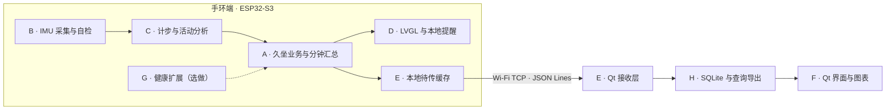

# smartwristband · ESP32-S3 智能健康手环

C++ 实训项目，采用 **ESP32-S3 手环终端 + Qt 电脑端**，完成运动采集、计步、活动强度分析、久坐提醒，以及记录同步、历史查询、图表和 CSV 导出。

本仓库当前收录八人分工与设计基线，便于组员认领、并行开发和交接。固件、正式 Qt 业务工程及整机实测结果将随开发逐步提交。教学原型使用明确标记的模拟／回放／真实数据，不用于医疗诊断或治疗。

## 先看这几份文档

| 入口 | 内容 |
|---|---|
| [八人分工总览](docs/分工/README.md) | A—H 岗位、交付物、协作顺序和阶段任务 |
| [00-总约定](docs/分工/00-总约定.md) | 姓名认领、目录归属、共享接口、集成规则与里程碑 |
| [功能表](docs/分工/功能表.md) | v0.2 范围基准：15 项 P0、4 项 P1、3 项 P2 范围排除 |
| [需求与验收](docs/分工/需求与验收.md) | 核心需求、测试方法、完成标准和证据要求 |
| [架构与界面草图](docs/分工/架构与界面草图.md) | 手环—Qt 功能链路、设备六页、提醒弹窗和电脑端布局 |

岗位方案沿用已确认的 v0.2 分工。具体姓名统一在总约定中补齐；目前使用 A—H 代号，**F 岗位已认领**。功能编号的前缀表示模块，和人员代号分别使用。

## 八人分工

| 岗位 | 主责与交付 | 主要功能编号 | 详细任务 |
|---|---|---|---|
| A · 统筹与集成 | 久坐业务、分钟汇总、模块装配、构建部署与验收演示 | A-03、I-01、I-02 | [A 任务卡](docs/分工/A-统筹集成与久坐逻辑.md) |
| B · 硬件与采集 | 板级自检、按键、统一 I²C 接口、MPU6050 50 Hz、马达驱动 | H-01、H-02 | [B 任务卡](docs/分工/B-板级驱动与运动采集.md) |
| C · 运动算法 | 滤波、动态峰值计步、活动强度、精度评估；疑似跌倒选做 | A-01、A-02、X-03 | [C 任务卡](docs/分工/C-计步算法与活动分析.md) |
| D · 手环界面 | 800×480 LVGL 六页、导航、主题、提醒弹窗与操作事件 | U-01 | [D 任务卡](docs/分工/D-LVGL界面与提醒交互.md) |
| E · 通信与缓存 | Wi-Fi TCP、鉴权、JSON Lines、Qt 接收解析、ACK、重发与补传 | C-01、C-02 | [E 任务卡](docs/分工/E-通信缓存与Qt接收.md) |
| F · Qt 界面与图表 | 桌面入口、连接配置、设备状态／档案界面、查询和 Qt Charts；轻量看板选做 | P-01、P-02、X-04 | [F 任务卡](docs/分工/F-Qt界面与图表.md) |
| G · 健康扩展 | 温度、心率／血氧采集与有效性；早期协助器件、自检与异常复测 | X-01、X-02 | [G 任务卡](docs/分工/G-健康传感器扩展.md) |
| H · 数据与测试协调 | SQLite、可靠入库、查询、实际 CSV 导出、两端对账与测试索引 | D-01、D-02、P-03 | [H 任务卡](docs/分工/H-数据库查询与导出.md) |

E 负责网络实现，H 负责数据库与实际导出，F 负责界面入口和展示；A 管理久坐业务状态，D 提交交互事件，B 执行硬件动作。每人承担本模块代码、说明和自测，A 集成，H 协调用例与证据索引。

## 系统怎样工作



手环在断网时继续采集、计步、计时和本地提醒，保存待同步记录；连接恢复后补传。电脑端接收、归档、查询和可视化，存储成功后再确认对应记录。

## 功能范围

**P0 必做共 15 项**，逐项定义见功能表，覆盖：

- 硬件初始化、自检和统一接口，MPU6050 50 Hz 运动采集。
- 滤波计步、活动强度与 45 分钟久坐提醒。
- LVGL 六页、本地马达与弹窗反馈、稍后和复位。
- 鉴权、TCP／JSON Lines、待传缓存、ACK、去重与断网补传。
- Qt 连接配置、设备状态、分钟数据、历史查询和图表。
- SQLite 持久化、CSV 导出、可复现构建与演示。

**P1 选做共 4 项**：温度趋势、心率／血氧趋势、疑似跌倒与取消、移动端或轻量看板。疑似跌倒继续保留为选做。X-04 看板与 N-03 对 App／第二平台的边界仍待组内确认，先完成并验证全部 P0，再评估接入。

**P2 为范围排除项**：医疗诊断与治疗建议、电池管理与充电设计、复杂云平台／多租户／手机 App／PC 实时告警中心。范围变更需同步功能表、总约定、任务卡和验收方法。

## 验收目标

| 验收主题 | 目标与证据 |
|---|---|
| 计步精度 | 真实行走 5 组 × 100 步，每组误差 ≤ 3 步，保留逐组数据和配置 |
| 久坐提醒 | 45 min ± 10 s，稍后／复位及状态边界正确，保留日志和演示 |
| 通信可靠 | 半包、多行、非法输入、丢 ACK、断网恢复等场景可复现；不重复入库、可补传 |
| 存储与展示 | 发送清单、SQLite、查询、图表与 CSV 的记录数量及内容一致 |
| 部署复现 | 另一组按版本清单和部署说明可独立构建、运行与复测 |

以上为验收目标，完成状态以实际代码、测试记录和证据为准。早期界面草图、本机工具链检查和模拟演示分别记录，不替代真机验收。

## 技术与开发环境

| 部分 | 路线 | 版本状态 |
|---|---|---|
| 终端 | ESP32-S3、ESP-IDF、I²C、MPU6050、LVGL | IDF／LVGL／屏幕与引脚配置随课堂基础工程和实物统一 |
| 桌面 | C++、Qt Widgets、Qt Network、Qt SQL、Qt Charts、SQLite | F 本机已验证下列参考环境；全组统一版本仍需确认 |
| 扩展 | TMP117 等温度传感器、MAX30102 等光学传感器 | 核对实际模块、驱动与数据有效性后独立调试 |

F 本机的参考环境为 **Qt 6.12.0、Qt Creator 20.0.2、MinGW 15.1.0、CMake 3.30.5、Ninja 1.12.1**。本机已完成基础窗口／图表、TCP 环回和 SQLite 运行检查。这些检查工程不包含在本次分工文档提交中，亦不表示整个项目已经实现。

Qt 工程使用英文目录，并优先采用已验证的 Ninja 构建方式。正式构建、烧录和运行命令随实际 `firmware/`、`desktop/` 工程接入后补充。

## 目录与协作

当前仓库内容：

```text
README.md
docs/
  分工/
    README.md
    00-总约定.md
    功能表.md
    需求与验收.md
    架构与界面草图.md
    A-统筹集成与久坐逻辑.md
    B-板级驱动与运动采集.md
    C-计步算法与活动分析.md
    D-LVGL界面与提醒交互.md
    E-通信缓存与Qt接收.md
    F-Qt界面与图表.md
    G-健康传感器扩展.md
    H-数据库查询与导出.md
```

后续源码计划归入 `firmware/`、`desktop/`、`contracts/`；验证与说明归入 `tests/`、`docs/modules/`、`evidence/`。这些目录的职责边界见总约定；接入老师工程时优先映射现有结构。

1. 先阅读总约定及自己的任务卡，补齐姓名和设备／版本信息。
2. 从主分支建立开发分支，按模块提交可以验证的小改动，通过 Pull Request 交维护者人工合并。
3. 共享数据、报文、数据库和跨模块接口变更先与使用方对齐，并同步说明。
4. 每次交付附修改范围、验证步骤、实际结果、证据位置和未解决事项。

本次仓库整理沿用分工方案 v0.2，整理日期为 **2026-11-09**；功能表保留原始版本日期，后续范围变更通过提交记录追溯。
