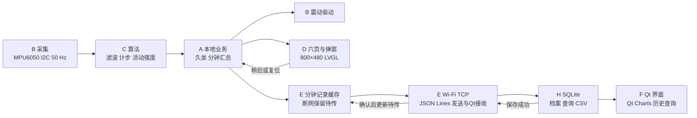

# 手环—Qt 系统功能图与初始界面草图

_设计稿 v0.2｜2026-11-07｜功能和技术来自课件；具体六页命名、布局、事件细则为组内建议，待认领与课堂确认。_

本图沿用原链路，与新[功能表](功能表.md)对齐；没有另造一套架构。硬件 H-01/H-02→B，算法 A-01/A-02→C，久坐 A-03→A，U-01→D，通信 C-01/C-02→E，P-01/P-02→F，D-01/D-02/P-03→H；I-01/I-02→A。功能编号前缀与人员代号不同。X-01/X-02→G，X-03→C，X-04→F，均为 P1。

## 1. 功能图

手环本地形成“采集—算法—提醒—交互—记录”流程，电脑负责接收、保存、查询与可视化。网络只影响同步，本地采集、计算、提醒和缓存持续运行。



不支持 Mermaid 的阅读器可看文字图：

```text
MPU6050 → 滤波／计步／活动强度 → 久坐业务
                                  ├→ 马达震动＋LVGL 弹窗 ← 稍后／复位
                                  └→ 分钟记录 → 本地缓存
                                                    ↓ Wi-Fi TCP / JSON Lines
                                    Qt 接收 → SQLite → 查询／Qt Charts／CSV
                                                    ↑ 保存后确认、断网恢复重发
```

G 的 X-01 温度／X-02 心率血氧、C 的 X-03 疑似跌倒与取消，均保留为独立可关闭扩展，仅全部 P0 通过后评估接入。F 的 X-04 复用现有数据，移动端与 N-03 手机 App／第二平台排除边界待确认；本图不新增独立云平台或远程告警链路。

## 2. 三段接口

| 位置 | 提供者 → 使用者 | 交付 |
|---|---|---|
| 传感器与算法 | B→C；G→A/D/E | 带单位、时间与有效性的样本 |
| 业务与交互 | C→A，A↔D，A→B/E | 活动、提醒状态、操作事件、分钟记录 |
| 记录与电脑 | E→H→F | 同一标识的记录、保存结果、实时状态和历史查询 |

记录字段、组件函数和数据库结构先写入共享约定再实现。E/F/H 在同一个 Qt 工程中合作；不分别建立三个桌面程序。

## 3. 手环六页导航初稿

以下六页名称是建议，不冒充老师已经指定的页面；都按 800×480 画布组织。

| 页面 | 展示内容 | 主要操作 |
|---|---|---|
| 首页 | 当前步数、活动状态、久坐计时、连接与器件状态 | 进入各页 |
| 运动 | 步数、活动强度、简化趋势／采集状态 | 查看当前运动状态 |
| 久坐 | 当前提醒状态、已计时、规则说明 | 稍后／复位，操作语义待确认 |
| 历史 | 本地分钟记录摘要 | 上下翻看，具体保存范围待确认 |
| 同步 | 网络状态、待传／已确认、异常提示 | 按约定重试连接 |
| 设置 | 设备标识、主题、器件自检与版本 | 切换主题、查看自检 |

```text
┌──────────────────────── 首页 ─────────────────────────┐
│ 设备：demo-device-01       采集状态：有效      网络：离线 │
│ 当前步数：--              活动强度：--                 │
│ 久坐计时：--              提醒状态：--                 │
│ [运动] [久坐] [历史] [同步] [设置]                      │
└───────────────────────────────────────────────────────┘

┌──────────────────────── 运动 ─────────────────────────┐
│ [返回]   步数：--   强度：--   数据来源：待采集         │
│ [活动趋势区域]                 [传感器与采样状态]      │
└───────────────────────────────────────────────────────┘
┌──────────────────────── 久坐 ─────────────────────────┐
│ [返回]   计时：--   当前状态：--                       │
│ [稍后] [复位]          规则和按钮语义以确认稿为准       │
└───────────────────────────────────────────────────────┘
┌──────────────────────── 历史 ─────────────────────────┐
│ [返回]   分钟记录：时间／步数变化／活动／提醒           │
│ [记录列表]                                    [上/下] │
└───────────────────────────────────────────────────────┘
┌──────────────────────── 同步 ─────────────────────────┐
│ [返回]   网络：--   待传：--   已确认：--               │
│ 最近同步：--       错误／恢复状态：--                  │
└───────────────────────────────────────────────────────┘
┌──────────────────────── 设置 ─────────────────────────┐
│ [返回]   设备标识：--   版本：--   主题：[切换]         │
│ 自检：IMU --／马达 --／健康扩展 未启用                 │
└───────────────────────────────────────────────────────┘
```

提醒弹窗覆盖当前页面，由 A 的业务状态驱动；与马达动作保持一致：

```text
┌──────────────────── 久坐提醒 ────────────────────┐
│ 已达到提醒条件，请起身活动。                     │
│ 当前状态与计时：--                               │
│              [稍后]       [复位]                 │
└─────────────────────────────────────────────────┘
```

此处 `--` 为设计占位，不是测量结果。选做健康功能可放在现有页面的扩展区域，先不挤占六个核心页面。

## 4. Qt 初始界面草图

```text
┌────────────────── 智能健康手环 · 数据端 ──────────────────┐
│ 连接配置：[IP／地址] [端口] [设备标识] [连接／断开]        │
│ 连接状态：--  最近收包：--  数据来源：真实／模拟／回放      │
├──────────────┬───────────────────────────────────────────┤
│ 设备档案     │ [设备选择] [时间范围] [查询] [导出 CSV]   │
│ demo-01      ├───────────────────────────────────────────┤
│ demo-02      │ 步数：--  活动：--  提醒：--              │
│ [档案操作]   │ [Qt Charts 实时／历史曲线]                │
│              ├───────────────────────────────────────────┤
│              │ [记录表：设备／会话／序号／时间／数值]    │
├──────────────┴───────────────────────────────────────────┤
│ 入库状态：--  重复记录：--  补传状态：--  最近错误：--     │
└──────────────────────────────────────────────────────────┘
```

F 负责 P-01 参数与状态界面、P-02 分钟记录实时／历史图表及导出入口；E 执行实际连接／断开、鉴权与解析，H 负责档案、查询和 P-03 实际 CSV。TCP 监听／主动连接方向待 E 核对，不由草图写死。收包、待传、入库、错误分别显示；收到不等于入库成功。50 Hz 原始采样与分钟记录展示不是同一频率，实时久坐提醒仍在设备本地执行。

既有 F0 浏览器原型、截图和 v0.2 差距对照保留在组内历史归档，尚不包含全部新配置能力；当前目标见[F 任务卡](F-Qt界面与图表.md)，不以旧截图宣布 P-01／P-02 已通过。

## 5. 第一课阶段的组内检查

- 功能图是否覆盖必做各环节，是否明确选做接入位置？
- D/F 是否能依据草图解释每个区域的数据来源与按钮作用？
- A/B 是否明确马达业务与驱动的交接？E/H 是否明确缓存、保存和确认的交接？
- 六页名称、稍后规则等待确认项是否清楚标注，而不是假装已由老师定稿？
- 图、需求表和分工中的名称是否一致？
